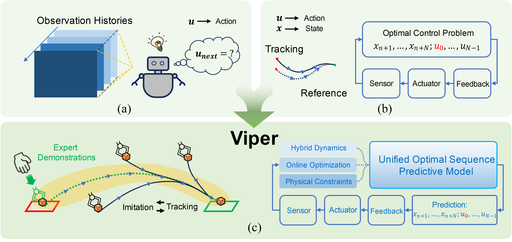
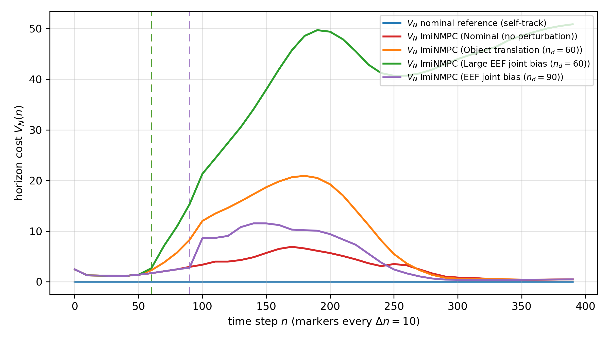

# Viper: Verifiable Imitation Learning Policy for Efficient Robotic Manipulation

<div align="center">

[](https://cheng122.github.io/Viper)
[](./LICENSE)

</div>

<p align="center">
    
<p>

We introduce **Viper**, a novel visuomotor policy framework that integrates the principles of NMPC with robotic IL. 

## 📦 Installation

### Requirements

> Please refer to the [ACT](https://github.com/tonyzhaozh/act) or [lerobot](https://github.com/huggingface/lerobot). Our project can run in the ACT/lerobot environment.

- Python 3.8+
- PyTorch 1.13+
- CUDA 11.0+

### Setup

```bash
# Clone the repository
git clone https://github.com/Cheng122/Viper.git
cd Viper

# Install dependencies: provide our requirements.txt as a reference
pip install -r requirements.txt
```

## 🚀 Quick Start

### 1. Generate Demonstration Data

```bash
python dataset_utils/record_sim_episodes.py \
    --task_name sim_insertion_scripted \
    --dataset_dir <> \
    --num_episodes 200
```

### 2. Train the Policy

```bash
python imitate_episodes.py \
    --task_name sim_insertion_scripted \
    --ckpt_dir <> \
    --num_epochs 2500 \
    --batch_size 16 \
    --horizon_size 50
```

### 3. Evaluate the Policy

```bash
python imitate_episodes.py \
    --task_name sim_insertion_scripted \
    --ckpt_dir <> \
    --horizon_size 50 \
    --eval
```

> Similar to ACT, for real-world data where things can be harder to model, please train for more epochs. 

## 🎯 Simulation Benchmark

Viper enables robots to learn complex bimanual manipulation skills from demonstration data. This project shows four simulation tasks using the ViperX dual-arm robot:

| Task | Description |
|------|-------------|
| **Transfer Cube** | Pick up a cube with right arm and transfer to left arm |
| **Insertion** | Insert a peg into a socket using both arms |
| **Stack Cube** | Stack one cube on top of another |
| **Storage Cube** | Place a cube into a storage box |

## Perturbation Recovery Experiments

We provide the original local evaluation code and saved insertion experiments for
object translations and arm joint offsets. The rollout logic, perturbations, cost
calculation, plots, and videos retain the original experiment definitions.



| Case | Perturbation | Final sampled cost | Video with cost curve |
| --- | --- | ---: | --- |
| Nominal | None | 0.482 | — |
| Object translation | Both objects: (+0.05, +0.05, 0) m at step 60 | 0.454 | [Video](results/lyapunov_insertion_dist_obs/rollout_obs_dist60_sync.mp4) |
| Joint offset | Both arms: (0.4, −0.4, −0.4, 0.4, −0.4, 0) rad at step 90 | 0.476 | [Video](results/lyapunov_insertion_dist_eef/rollout_eef_dist90_sync.mp4) |
| Large joint offset | Left: (1,1,1,1,0,0); right: (0,1,1,1,1,0) rad at step 60 | 50.869 | [Video](results/lyapunov_insertion_huge_dist_eef/rollout_huge_eef_dist60_sync.mp4) |

The two smaller perturbations show a recovery in tracking cost and visible
insertion in video review; the large joint offset does not recover within the
rollout. These four cases are not a statistical success-rate benchmark. The
original automatic success labels remain 0: the environment requires contact
with the internal `pin`, which differs from visually entering the socket.

### Run an experiment

Use the Viper simulation environment with CUDA and a compatible horizon-50
checkpoint. The checkpoint directory must contain `policy_best.ckpt` and its
matching `dataset_stats.pkl`. The reference HDF5 must include `/meta/env_state`.
The original reference has 400 recorded steps followed by 50 repeated tail steps;
checkpoint and reference files are not included in this code/results release.

```bash
python eval_lyapunov.py \
    --gpu 0 --task_name sim_insertion_scripted \
    --ckpt_dir /path/to/checkpoint_directory \
    --dataset_dir /path/to/reference_directory --episode_id 0 \
    --results_dir results/new_object_run \
    --disturb_type object --disturb_t 60 --delta_xyz 0.05 0.05 0 \
    --lyapunov_log_stride 10 --omega_pro 1.0 --omega_img 1.0 --lam_u 1.0 \
    --save_video
```

Use a new results directory to preserve the archived runs. `eef` denotes joint
position offsets in radians; `object` denotes a translation in meters. Original
commands are retained in each result directory's `dist.md`; replace their local
paths before rerunning. The original qpos/action cost references remain
`t … t+49`; the expert zero line is reference self-comparison.

Plotting tools are `other_utils/plot_lyapunov_figure.py`,
`other_utils/plot_lyapunov_compare.py`, and
`other_utils/make_lyapunov_video_with_plot.py`. The four result directories retain
the original NPZ, JSON, PNG, raw videos and synchronized videos where available.

## 🙏 Acknowledgments

- This project builds upon the DETR architecture
- Simulation environment based on dm_control
- Inspired by [ACT](https://github.com/tonyzhaozh/act) and related imitation learning works

## 📝 Citation

If you find this work useful, please cite:

```bibtex
@inproceedings{cheng2026viper,
  title={Viper: Verifiable Imitation Learning Policy for Efficient Robotic Manipulation}, 
  author={Cheng, Xianfeng and Gao, Qing and Chen, Guangyu and Xiong, Rui and Hu, Junjie and Guo, Yulan and Zhao, Jieju},
  booktitle={2026 IEEE International Conference on Robotics and Automation (ICRA)},
  pages={x-x},
  year={2026},
  organization={IEEE}}
```
